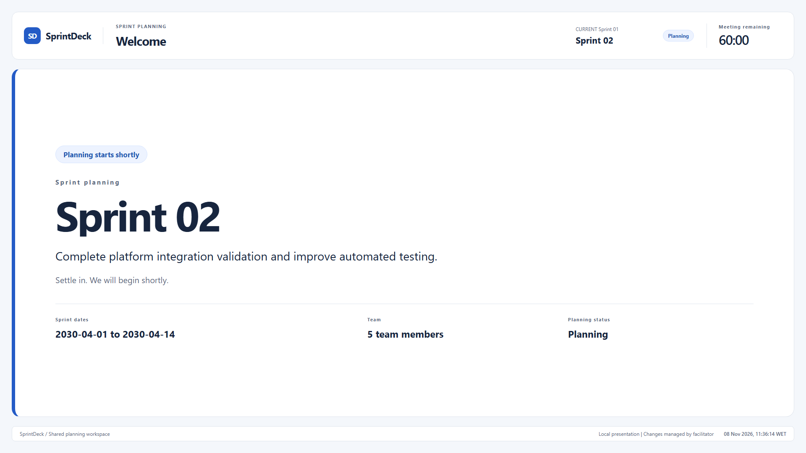
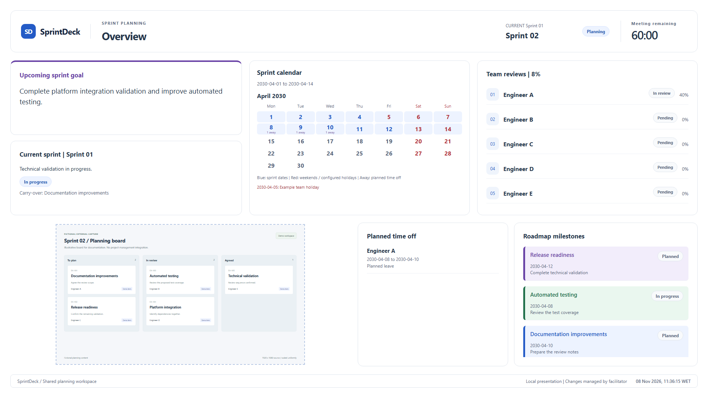
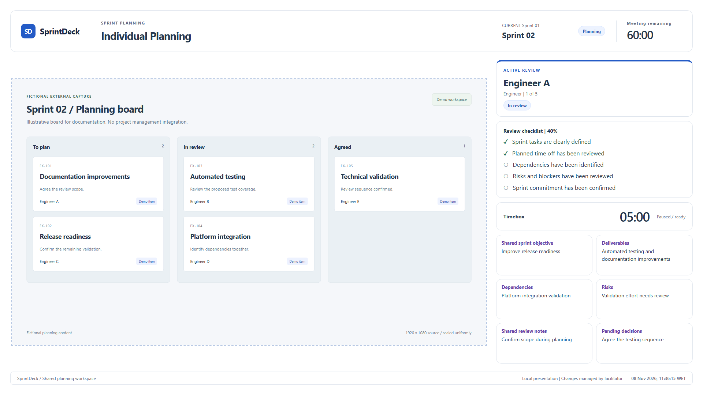
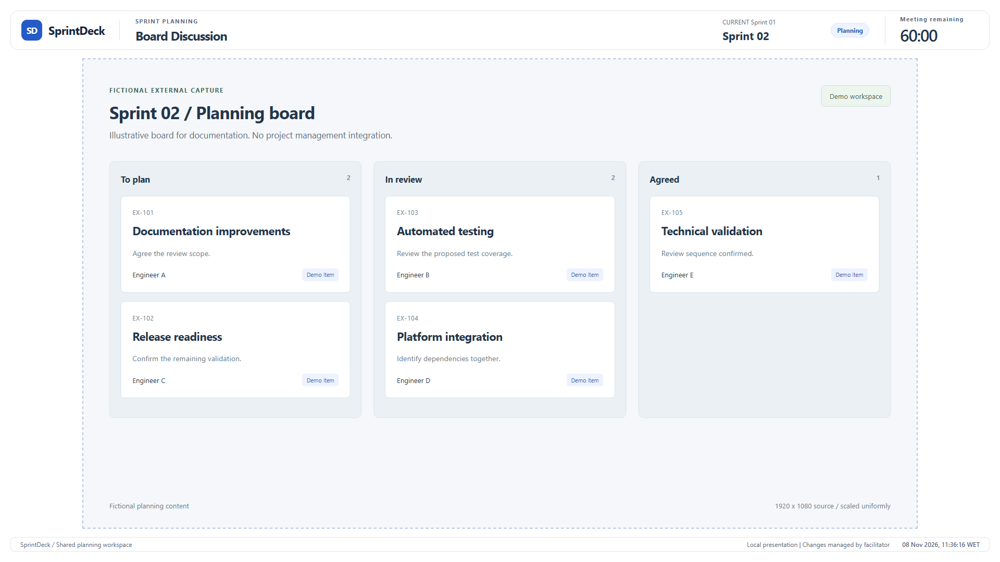
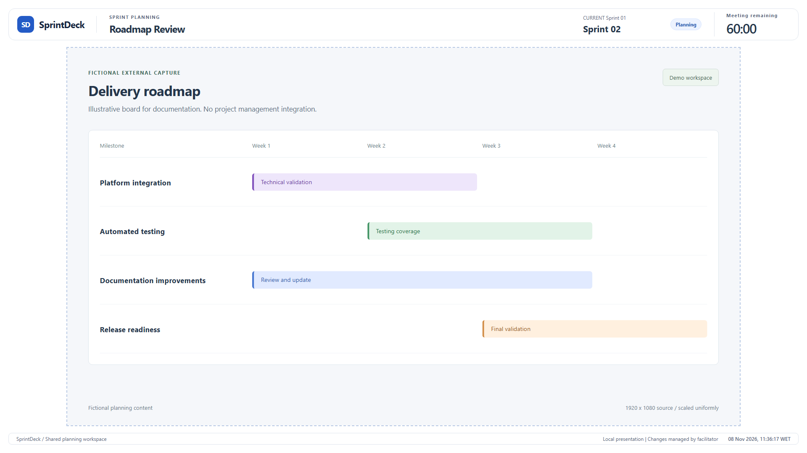
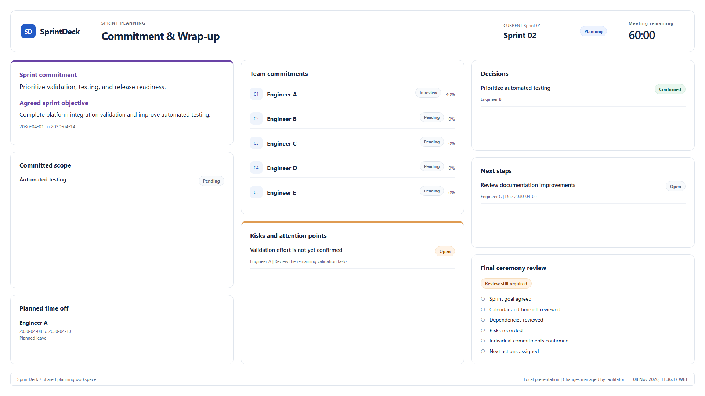

# Scenes and screenshots

The facilitator edits one local session. Audience overlays show the same saved state through OBS Browser Sources. Keep the controller off the shared output. All screenshots below use fictional data. Boards and timelines are illustrative external captures composed in a browser, not OBS screenshots or a Jira integration.

## Welcome

Use `/overlays/welcome` while people join. The sprint name is deliberately large. The goal, dates, team count, planning status, and local clock provide context. The opaque background hides capture sources beneath it. Opening this view does not start the meeting timer.

## Overview

Use `/overlays/overview` to align the team before individual reviews. It combines the sprint goal, current sprint summary, full-month calendar, configured holidays, time off, team checklist progress, roadmap milestones, and a small external capture aperture. Milestone colors are selected manually and do not imply a status change.

## Individual Planning

Use `/overlays/individual` for the main review. The controller selects the active member without changing the OBS scene. Checklists and confirmation remain separate for each member; objectives, deliverables, dependencies, risks, shared notes, and pending decisions remain common. Changing members does not reset the individual timer. Capacity stays in the captured application.

## Board Discussion

Use `/overlays/discussion` for general topics that need a larger application view. Its compact header leaves a 1600 x 900 aperture on a 1920 x 1080 canvas. A 1080p source scales uniformly into that aperture.

## Roadmap Review

Use `/overlays/roadmap` for a separate roadmap application capture. It uses the same large 16:9 aperture as Board Discussion. It does not fetch or generate a roadmap. The manually entered milestones remain visible in Overview.

## Commitment and Wrap-up

Use `/overlays/wrapup` to confirm the goal and scope, review commitments, address risks, and assign next steps. A selected member is not automatically confirmed. Pending scope and incomplete final checks remain visibly pending. Session notes stay private; shared review notes are audience context.

## Capture dimensions and rehearsal

All capture apertures preserve 16:9 for complete 1920 x 1080 sources. See [OBS setup](obs-setup.md) for source ordering, positions, scale factors, and transparency checks. The overlays scale to a 1280 x 720 canvas, but audience readability depends on the meeting setup. Rehearse the actual output rather than relying on screenshots alone.
